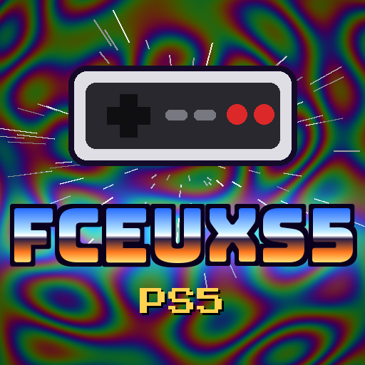

# fceuxs5

An NES and Famicom emulator for jailbroken PS5 consoles, built on **[FCEUX](https://github.com/TASEmulators/fceux)**. It runs as a native PS5 app: it has its own icon on the home screen, and it opens with an intro and has an interface you choose.



## Features

- **The FCEUX core** (2.8, `TASEmulators/fceux` master): NES, Famicom, Famicom Disk System, VS. System, UNIF and NES 2.0. Supports hundreds of mappers.
- **Three interfaces.** You pick one the first time the app starts, and you can change it any time in *Settings > Interface*:
  - **Channel**: a framed game list with the selected game's box art beside it, and rounded Settings and Exit buttons.
  - **Station**: sky, clouds and rolling hills, a big multicoloured title, and a translucent list of game names.
  - **Flow**: your box art in a 3D cover flow on a light floor, with an icon bar, a clock and the game count.
- **Intro and menu music.** An "fceuxs5" demo intro (starfield, chrome logo, glitches, plasma, a sine scroller and an explosion) plays at start-up; Cross skips it. A keygen-style tune loops in the menus. Both can be turned off in Settings.
- **Box art.** Covers are downloaded automatically from [libretro-thumbnails](https://github.com/libretro-thumbnails/Nintendo_-_Nintendo_Entertainment_System). Games are matched by their No-Intro name, found from the ROM's CRC, so oddly named files still get their cover. You can also use your own: `covers/NES/<game>.png`.
- **CRT filters.** Eleven CRT shaders, ported to the CPU and on by default: CRT Easymode style, crt-lottes, crt-lottes-fast, crt-1tap, crt-2tap, crt-hyllian-fast, crt-nobody, newpixie-mini, crt-blurPi sharp and soft, and monoCRT. They give scanlines, an aperture mask, curvature and glow.
- **Upscaling.** FCEUX's own filters: hq2x, hq3x, Scale2x, Scale3x, prescale 2x/3x/4x, PAL blend, and Blargg's NTSC filter (composite, S-Video, RGB, monochrome). They combine with the CRT shaders, so NTSC composite + CRT works. You can also choose integer scaling, 8:7, 4:3 or 16:9, and a smooth or sharp picture.
- **ROM hacks.** IPS, UPS and BPS patches are applied in memory when the game starts, so your ROM file is never changed. Put `Game.ips` (or `.bps` or `.ups`) next to `Game.nes` and it is used automatically. Press □ on a game to choose between several patches or play the original. A patched game keeps its own saves.
- Save states (10 slots), rewind (L2 + R2), fast forward (R2), turbo buttons, button remapping, 4 players (Four Score and the Famicom adapter), battery saves, `.zip`/`.7z` games, SMB/NFS network shares, and USB drives.

## Installing

You need a PS5 that can run homebrew (etaHEN or kstuff, with a launcher such as ShadowMountPlus or the ProsperoStore).

- **Easiest:** install it from the ProsperoStore.
- **By hand:** download `fceuxs5-v1.0-PPSA51855.zip` from [Releases](../../releases). Unzip it to `/data/homebrew/` (or `/mnt/usbX/homebrew/`) so that you have `homebrew/PPSA51855/eboot.bin`. Then register it with your launcher.
- **Or:** send `fceuxs5-v1.0.elf` to your ELF loader (port 9021). It installs or updates the app and puts the icon on the home screen.

## Where things go

| What | Where |
|---|---|
| Games (`.nes .unf .fds .nsf .zip .7z`) | `/data/fceuxs5/roms/` or `fceuxs5/roms/` on a USB drive |
| ROM hacks (`.ips .bps .ups`) | next to the game, or in `/data/fceuxs5/patches/` (or `patches/<game>/`) |
| Famicom Disk System BIOS | `/data/fceuxs5/bios/disksys.rom` |
| Saves, states, covers, logs | `/data/fceuxs5/saves`, `states`, `covers`, `logs` |

No games, BIOS files or box art come with fceuxs5. Use your own dumps.

## Controls

| Where | Buttons |
|---|---|
| Library | ✕ play · D-pad browse · L1/R1 storage · □ game options (ROM hacks, box art) · △ settings · OPTIONS quit |
| In game | NES pad on the D-pad, ✕/○ (B/A), □/△ (turbo B/A), OPTIONS = Start, touchpad = Select |
| Hot keys | L3 + R3 menu · L2 + ↑/↓ save/load state · L2 + ←/→ state slot · R2 fast forward · L2 + R2 rewind |

## Building

You need Linux, clang/lld 18 and [ps5-payload-sdk v0.42](https://github.com/ps5-payload-dev/sdk/releases/tag/v0.42) in `/opt/ps5-payload-sdk`.

```sh
cd ps5
make app     # build/app/PPSA51855/ (eboot.bin, sce_module/libc.prx, sce_sys/)
make dist    # build/dist/: the app zip, the installer ELF and the source zip
make host    # a Linux build with a fake PS5 underneath, for testing (build/host/fceuxs5-host)
```

`ps5/tools/make_intro.py` renders the intro video and `ps5/tools/make_art.py` draws the icon and backgrounds.

## Credits and licences

fceuxs5 as a whole is **GPL-3.0-or-later** (`LICENSE`).

- **FCEUX** (`src/`, unchanged): the FCEUX team, GPL-2.0-or-later (`COPYING`).
- **PS5 port layer** (`ps5/`): video, audio, pads, the sandbox helper, the installer, covers and CRT shaders come from [MisterTemaki/fceummPS5](https://github.com/MisterTemaki/fceummPS5) (MIT, its credits kept in each file). The native-app tooling comes from [drakmor/ps5-native-app-boilerplate](https://github.com/drakmor/ps5-native-app-boilerplate) (GPL-3.0). fceuxs5 adds the FCEUX driver (`ps5/fceux/`), the three interfaces, the intro, the music player, the patcher and the upscaler integration.
- Libraries: pl_mpeg (MIT), dr_mp3 (public domain / MIT-0), stb (public domain), Mbed TLS (Apache-2.0), zlib, minizip, LZMA SDK, libsmb2 / libnfs (LGPL).
- Fonts: Varela Round and Bungee (SIL OFL 1.1), Press Start 2P (OFL, intro only), Roboto (Apache-2.0), PromptFont (OFL).
- Data: Mesen's NES header database and palettes, No-Intro names, and libretro-thumbnails box art (downloaded at run time).
- **Intro soundtrack and menu music:** the audio of the Razor 1911 "GTA IV" crack intro, and "CORE – Keygen Music 02". These belong to their authors and are **not** covered by the GPL. They are included as the project's chosen soundtrack. Replace `ps5/frontend/assets/media/` if you redistribute fceuxs5 without them.
